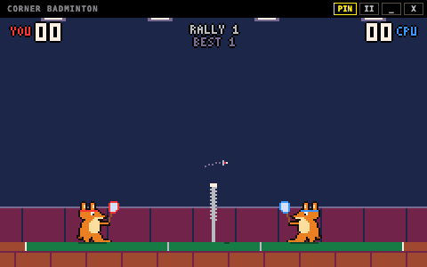

# Corner Badminton

화면 구석에 작은 체육관을 하나 띄워둡니다.
코드를 짜다가, 문서를 쓰다가 잠깐 손이 비면 셔틀콕을 한 번 넘기면 됩니다. 창은 다른 창 위에 떠 있지만 480×300 크기라서 하던 일을 가리지 않습니다.



## 조작

| 키 | 동작 |
| --- | --- |
| A / D | 좌우로 움직입니다 |
| W | 점프합니다 |
| Space | 라켓을 휘두릅니다. 서브도 Space입니다 |
| Esc | 잠깐 멈추고 메뉴를 엽니다 |

방향키(← → ↑)로도 움직일 수 있습니다. 창은 맨 위 검은 막대를 잡고 끌어서 옮깁니다.

## 규칙

### 코트 안에 떨어지면 그쪽이 실점합니다

셔틀콕이 초록색 코트 안에 떨어지면 떨어진 쪽이 점수를 잃습니다. 바닥의 흰 선 위에 떨어져도 안으로 칩니다.

### 밖으로 나가면 마지막에 친 쪽이 실점합니다

너무 세게 쳐서 선 밖으로 나가면 상대에게 점수를 줍니다. 네트에 걸려 내 코트로 떨어져도 마찬가지입니다.

### 휘두를 때 누르고 있던 방향이 샷을 정합니다

네트 쪽으로 누르고 치면 네트 바로 너머로 짧게 떨어지는 드롭이 됩니다. 반대로 누르고 치면 상대 코트 깊숙이 날아가는 클리어가 됩니다. 아무것도 누르지 않으면 그 중간쯤으로 갑니다.

### 높이 뛰어서 치면 스매시입니다

점프해서 네트보다 높은 곳에서 맞히면 셔틀콕이 아래로 꽂힙니다. 네트에서 멀면 각도가 나오지 않아 평범한 샷이 됩니다.

### 라켓 한가운데로 맞혀야 원하는 곳으로 갑니다

라켓 가장자리에 걸리면 셔틀콕이 엉뚱한 곳으로 가거나 네트에 걸립니다. 너무 일찍 휘두르지 말고 셔틀콕이 내려오는 걸 기다리세요. 바닥에 비치는 작은 그림자를 보면 어디로 떨어질지 가늠할 수 있습니다.

### 21점을 먼저 내면 이깁니다

20:20부터는 2점을 앞서야 이깁니다. 끝없이 이어지지는 않고 30점을 먼저 낸 쪽이 이깁니다. 랠리에서 이긴 쪽이 다음 서브를 넣습니다.

### CPU도 실수합니다

CPU는 셔틀콕이 떨어질 곳을 계산해서 따라가지만, 가끔 낙하지점을 잘못 읽거나 라켓을 일찍 휘두릅니다. 일시정지 메뉴의 `LEVEL`에서 EASY, NORMAL, HARD 중에 고를 수 있습니다.

### 자리를 비우면 알아서 멈춥니다

다른 창을 클릭하면 게임이 멈추고, 누르고 있던 키도 모두 풀립니다. 멈춰 있는 동안에는 화면을 다시 그리지 않아서 CPU를 거의 쓰지 않습니다. 돌아와서 Esc나 Space를 누르면 이어서 합니다.

## 받기

아래 링크를 누르면 바로 내려받아집니다. 받은 파일이 바뀌지 않았는지는 [SHA256SUMS.txt](https://github.com/YunGyeongee/corner-badminton-pixel/releases/download/v1.0.3/SHA256SUMS.txt)로 확인할 수 있고, 지난 버전은 [Releases](https://github.com/YunGyeongee/corner-badminton-pixel/releases)에 있습니다.

| 컴퓨터 | 내려받기 |
| --- | --- |
| Mac (Apple Silicon) | [corner-badminton-1.0.3-mac-arm64.dmg](https://github.com/YunGyeongee/corner-badminton-pixel/releases/download/v1.0.3/corner-badminton-1.0.3-mac-arm64.dmg) |
| Windows 설치 파일 (x64, ARM 공통) | [corner-badminton-1.0.3-windows-setup.exe](https://github.com/YunGyeongee/corner-badminton-pixel/releases/download/v1.0.3/corner-badminton-1.0.3-windows-setup.exe) |
| Windows 압축 파일 (일반 PC) | [corner-badminton-1.0.3-windows-x64.zip](https://github.com/YunGyeongee/corner-badminton-pixel/releases/download/v1.0.3/corner-badminton-1.0.3-windows-x64.zip) |
| Windows 압축 파일 (ARM PC) | [corner-badminton-1.0.3-windows-arm64.zip](https://github.com/YunGyeongee/corner-badminton-pixel/releases/download/v1.0.3/corner-badminton-1.0.3-windows-arm64.zip) |

### macOS

Apple Silicon(M1 이상) Mac에서 실행됩니다. [corner-badminton-1.0.3-mac-arm64.dmg](https://github.com/YunGyeongee/corner-badminton-pixel/releases/download/v1.0.3/corner-badminton-1.0.3-mac-arm64.dmg)를 받습니다.

1. `.dmg`를 열고 Corner Badminton을 응용 프로그램 폴더로 끌어다 놓습니다.
2. 앱을 실행합니다. 아직 Apple 공증을 받지 않은 앱이라 처음에는 "확인되지 않은 개발자" 경고가 뜨고 열리지 않습니다.
3. **시스템 설정 → 개인정보 보호 및 보안**으로 가서 아래쪽의 **그래도 열기**를 누릅니다. 한 번만 하면 됩니다.
4. 화면 오른쪽 아래에 게임 창이 뜹니다. 바로 Space를 눌러 서브하면 됩니다.
5. 다른 창 위에 띄워두기 싫으면 위쪽의 `PIN` 버튼을 눌러 끕니다.
6. 끌 때는 위쪽의 `X` 버튼을 누르거나 Esc 메뉴에서 `QUIT`을 고릅니다.

3번이 안 되면 터미널에서 아래 명령을 한 번 실행해도 됩니다.

```bash
xattr -dr com.apple.quarantine "/Applications/Corner Badminton.app"
```

### Windows

Windows 10 이상에서 실행됩니다. [corner-badminton-1.0.3-windows-setup.exe](https://github.com/YunGyeongee/corner-badminton-pixel/releases/download/v1.0.3/corner-badminton-1.0.3-windows-setup.exe)를 받습니다. 설치 파일 하나로 일반 PC(x64)와 ARM PC를 모두 지원하고, 알아서 맞는 버전을 설치합니다.

1. 받은 설치 파일을 실행합니다.
2. 아직 코드 서명을 하지 않은 앱이라 "Windows의 PC 보호" 창이 뜹니다. **추가 정보**를 누른 뒤 **실행**을 누릅니다.
3. 관리자 권한 없이 내 계정에만 설치되고, 끝나면 바로 게임이 실행됩니다. 바탕화면과 시작 메뉴에 바로가기가 생깁니다.
4. 화면 오른쪽 아래에 게임 창이 뜹니다. 바로 Space를 눌러 서브하면 됩니다.
5. 다른 창 위에 띄워두기 싫으면 위쪽의 `PIN` 버튼을 눌러 끕니다.
6. 지울 때는 **설정 → 앱 → 설치된 앱**에서 Corner Badminton을 제거합니다.

설치하기 싫으면 `.zip`을 받아도 됩니다. 일반 PC는 [corner-badminton-1.0.3-windows-x64.zip](https://github.com/YunGyeongee/corner-badminton-pixel/releases/download/v1.0.3/corner-badminton-1.0.3-windows-x64.zip), ARM PC는 [corner-badminton-1.0.3-windows-arm64.zip](https://github.com/YunGyeongee/corner-badminton-pixel/releases/download/v1.0.3/corner-badminton-1.0.3-windows-arm64.zip)입니다. 압축을 풀고 `Corner Badminton.exe`를 실행하면 됩니다.

### 업데이트

앱이 스스로 업데이트하지는 않습니다. 새 버전이 나오면 위 [받기](#받기)의 링크로 다시 받아 위와 같이 설치하면 됩니다. 저장하는 데이터가 없어서 덮어써도 잃는 것은 없습니다.

- **macOS**: 새 `.dmg`를 열고 응용 프로그램 폴더로 끌어다 놓은 뒤, 같은 이름의 앱이 있다고 나오면 **대치**를 누릅니다. 새로 받은 앱이라 처음 실행할 때 "그래도 열기"나 `xattr` 명령을 다시 해야 할 수 있습니다.
- **Windows 설치 파일**: 게임을 끈 다음 새 설치 파일을 실행하면 기존 버전 위에 덮어써집니다. 먼저 지울 필요는 없습니다.
- **Windows `.zip`**: 새로 받은 압축을 풀어 실행하고, 예전 버전 폴더는 지웁니다.

## 어떻게 만들었나

Electron, TypeScript, Vite로 만들었고 게임 엔진은 쓰지 않았습니다. 화면은 240×140 크기의 캔버스에 그린 다음 픽셀을 번지지 않게 키웁니다. Retina처럼 정수배로 딱 맞으면 정수배로, Windows의 125% 배율처럼 정수배로는 빈 테두리가 크게 남으면 창에 맞춰 키웁니다. Mac과 Windows가 같은 코드를 씁니다. 캐릭터, 라켓, 셔틀콕, 글꼴까지 전부 코드 안의 작은 픽셀 배열로 그렸고 외부 그림 파일은 없습니다.

게임 로직(`src/game`, `src/entities`)은 화면과 분리되어 있어서 테스트에서 CPU끼리 21점 경기를 끝까지 치르게 할 수 있습니다. 렌더러는 Node.js에 접근할 수 없고, 창 제어에 필요한 기능 네 가지(항상 위 표시 확인·변경, 최소화, 닫기)만 preload를 통해 받습니다. 네트워크 통신은 하지 않으며 카메라·마이크 같은 권한 요청은 모두 거절합니다. 배포용 앱은 Electron fuse로 Node 실행 모드와 디버거 옵션을 끄고, 앱 파일이 변조되면 실행되지 않게 했습니다.

<details>
<summary>버전 기록</summary>

### 1.0.3

- 앱 아이콘을 넣었습니다.
- 게임 내용은 1.0.2와 같습니다.

### 1.0.2

- CPU를 더 약하게 했습니다. 특히 기본 난이도인 NORMAL이 많이 쉬워져서, 이전 EASY와 비슷한 수준이 됐습니다.
- CPU가 더 느리게 움직이고, 반응이 늦고, 낙하지점을 더 자주 잘못 읽습니다. 밖으로 나갈 공을 받아 치는 일도 늘었습니다.
- HARD는 조금만 약해졌습니다.

### 1.0.1

- 라켓을 키웠습니다. 라켓이 더 크게 보이고, 공이 맞는 범위도 넓어져서 셔틀콕을 받아치기 쉬워졌습니다.
- 라켓 가장자리에 맞아 엉뚱한 곳으로 가거나 네트에 걸리는 일이 줄었습니다.
- CPU 라켓도 같이 커지는 만큼 CPU의 실수를 조금 늘려서, CPU가 더 강해지지 않게 맞췄습니다.

### 1.0.0

- 첫 버전입니다.
- CPU와 1:1 단일 게임, 21점제
- 드롭·클리어·스매시, EASY / NORMAL / HARD 난이도
- 항상 위 표시, 창 이동, 일시정지와 재시작
- macOS(Apple Silicon), Windows(x64, ARM64)

</details>
